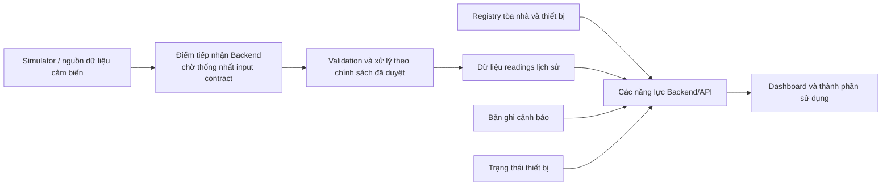

# Yêu cầu Backend/API và luồng dữ liệu

- Nguồn: [Issue #2 — Chốt yêu cầu Backend/API và luồng dữ liệu](https://github.com/nguyenthetai0012/SE2026---T06/issues/2)
- Trạng thái: bản nháp để nhóm rà soát. Tài liệu ghi nhận năng lực đã xác nhận và đánh dấu riêng các quyết định hợp đồng/thiết kế còn mở.
- Phạm vi: hành vi logic của Backend/API cho APP-05. Tài liệu không chọn công nghệ triển khai, đường dẫn endpoint, schema payload, sản phẩm lưu trữ hoặc chi tiết triển khai môi trường.

## 1. Phạm vi đã xác nhận

Backend/API cần hỗ trợ các năng lực sau:

1. Tiếp nhận dữ liệu cảm biến giả lập từ nhiều tòa nhà. MQTT ingestion thuộc phạm vi dự án đã xác nhận; broker, topic, payload, tùy chọn truyền nhận và contract validation vẫn chưa được chốt.
2. Quản lý và cung cấp thông tin registry tòa nhà/thiết bị.
3. Truy vấn dữ liệu cảm biến lịch sử theo thời gian.
4. Cung cấp cảnh báo tiêu thụ bất thường cho các thành phần sử dụng.
5. Cung cấp trạng thái online/offline của thiết bị.

Backend/API cung cấp dữ liệu cho Dashboard, gồm tổng quan năng lượng theo tòa nhà, lịch sử cảm biến, cảnh báo và trạng thái thiết bị. Các trường dữ liệu cụ thể cần thống nhất với người phụ trách Dashboard trước khi duyệt API contract.

## 2. Năng lực logic

| Năng lực | Hành vi cần có | Quyết định còn mở |
| --- | --- | --- |
| Tiếp nhận dữ liệu cảm biến | Nhận readings do simulator tạo cho thiết bị ở nhiều tòa nhà. Áp dụng input contract đã thống nhất với người phụ trách simulator/data và báo kết quả từng input được chấp nhận hay từ chối. | Trường bắt buộc, quy tắc định danh, ý nghĩa timestamp, validation, phản hồi khi input không hợp lệ, xử lý trùng lặp và cấu hình MQTT. |
| Device registry | Cung cấp liên hệ tòa nhà/thiết bị và thông tin thiết bị cần để nhận diện readings và phục vụ truy vấn Dashboard. | Trường registry, vòng đời cần hỗ trợ, quy tắc ID và cách xử lý thiết bị chưa đăng ký. |
| Truy vấn lịch sử | Trả readings theo phạm vi tòa nhà/thiết bị/cảm biến và khoảng thời gian được hỗ trợ; giữ liên hệ bản ghi với thiết bị và timestamp nguồn. | Bộ lọc, biên khoảng thời gian, timestamp dùng để sắp xếp, múi giờ, phân trang và tổng hợp. |
| Cảnh báo | Cung cấp các bản ghi cảnh báo và gắn với tòa nhà/thiết bị liên quan khi dữ liệu có thông tin đó. | Quy tắc/ngưỡng bất thường, trường cảnh báo, vòng đời/trạng thái, chống trùng và thao tác xác nhận. |
| Trạng thái thiết bị | Cung cấp trạng thái online/offline cho thiết bị đã đăng ký. | Heartbeat/last-seen, thời hạn offline, grace period và cách xử lý khi thiết bị kết nối lại. |

## 3. Luồng dữ liệu logic

### FLOW-01 — Tiếp nhận một reading cảm biến

1. Simulator tạo reading cho thiết bị/tòa nhà theo contract được thống nhất với người phụ trách data.
2. Backend nhận reading qua luồng MQTT ingestion đã thống nhất.
3. Backend kiểm tra reading theo input contract đã duyệt.
4. Reading hợp lệ có thể được truy vấn lịch sử với liên hệ thiết bị và timestamp nguồn được giữ nguyên.
5. Reading bị từ chối có kết quả phân biệt; hình thức phản hồi và biểu diễn lỗi là quyết định của contract.

### FLOW-02 — Đăng ký và xác định thiết bị

1. Thiết bị được biểu diễn trong registry tòa nhà/thiết bị bằng các định danh nhóm thống nhất.
2. Luồng tiếp nhận và truy vấn phân giải thiết bị về đúng tòa nhà thông qua registry.
3. Thành phần sử dụng có thể lấy thông tin và trạng thái thiết bị cần cho use case đã duyệt.

Các thao tác vòng đời registry và trường dữ liệu cần được nhóm xác nhận trước khi thiết kế endpoint/schema.

### FLOW-03 — Truy vấn readings lịch sử

1. Thành phần sử dụng yêu cầu readings theo đối tượng và khoảng thời gian đã thống nhất.
2. Backend chỉ trả các readings phù hợp phạm vi và khoảng thời gian đó.
3. Kết quả giữ liên hệ thiết bị nguồn và ý nghĩa timestamp theo data contract.
4. Kết quả rỗng phân biệt được với lỗi truy vấn.

### FLOW-04 — Đọc cảnh báo và trạng thái thiết bị

1. Năng lực cảnh báo cung cấp các bản ghi được tạo theo chính sách cảnh báo nhóm đã duyệt.
2. Năng lực trạng thái cung cấp trạng thái từng thiết bị đăng ký theo chính sách offline nhóm đã duyệt.
3. Dashboard nhận các trường đã thống nhất với người phụ trách; Backend không tự đặt ngưỡng cảnh báo hoặc thời hạn offline.

## 4. Tiêu chí nghiệm thu

Các tiêu chí dưới đây có thể kiểm tra bằng fixtures có kiểm soát sau khi input/output contract liên quan được duyệt.

| ID | Tiêu chí nghiệm thu |
| --- | --- |
| AC-01 | Với fixture reading hợp lệ cho thiết bị đã đăng ký, năng lực tiếp nhận chấp nhận reading và truy vấn lịch sử lấy lại được reading đó với đúng thiết bị và timestamp nguồn. |
| AC-02 | Với fixture reading không hợp lệ, Backend báo từ chối phân biệt với chấp nhận và không cung cấp input đó như reading lịch sử hợp lệ. Quy tắc validation và trường lỗi cụ thể theo input contract được duyệt. |
| AC-03 | Với fixtures registry có thiết bị thuộc ít nhất hai tòa nhà, tra cứu registry trả đúng liên hệ thiết bị–tòa nhà cho từng thiết bị, không gắn chéo bản ghi. |
| AC-04 | Với readings của nhiều thiết bị và khoảng thời gian, truy vấn chỉ trả bản ghi khớp phạm vi/khoảng đã yêu cầu; quy tắc biên khoảng và thứ tự kết quả khớp time contract được duyệt. |
| AC-05 | Với fixtures dữ liệu đến trễ và sai thứ tự, kết quả truy vấn tuân theo chính sách late-data được nhóm duyệt. Chính sách phải được ghi lại trước khi đánh dấu tiêu chí này đạt. |
| AC-06 | Với fixture cảnh báo sinh theo rule đã duyệt, thành phần sử dụng truy xuất được cảnh báo cùng liên hệ và trường dữ liệu đã duyệt. Fixture bình thường không sinh cảnh báo trừ khi rule được duyệt quy định như vậy. |
| AC-07 | Với thiết bị có trạng thái theo chính sách offline đã duyệt, thành phần sử dụng nhận đúng trạng thái online/offline cho từng thiết bị. Giá trị last-seen (nếu có) khớp ý nghĩa timestamp đã thống nhất. |
| AC-08 | Với các trường đã thống nhất cùng người phụ trách Dashboard, phản hồi Backend cung cấp dữ liệu cần cho tổng quan theo tòa nhà, lịch sử cảm biến, cảnh báo và trạng thái offline mà không làm thay đổi ý nghĩa dữ liệu giữa các luồng truy vấn. |
| AC-09 | Kết quả truy vấn rỗng và truy vấn thất bại phân biệt được với nhau đối với thành phần sử dụng. |
| AC-10 | Một contract/integration check chạy luồng producer → intake → history theo contract đã duyệt và báo kết quả thực tế với fixtures hợp lệ và không hợp lệ. |

## 5. Phối hợp, kết luận hiện tại và quyết định còn mở

Bảng này tách yêu cầu APP-05 đã xác nhận khỏi các góp ý yêu cầu dữ liệu và các quyết định contract chưa được nhóm thống nhất. Góp ý của Sương trong [PR #9](https://github.com/nguyenthetai0012/SE2026---T06/pull/9) là căn cứ cho ý nghĩa dữ liệu Dashboard; [yêu cầu Dashboard đã merge qua PR #8](https://github.com/nguyenthetai0012/SE2026---T06/blob/main/docs/requirements/dashboard.md) là tài liệu đối chiếu. Việc ghi nhận một yêu cầu không có nghĩa schema, chính sách hay contract tương ứng đã được duyệt.

| Nội dung cần thống nhất | Kết luận hiện tại | Người xác nhận | Trạng thái |
| --- | --- | --- | --- |
| Input reading contract: trường/định danh cần có, validation và kết quả chấp nhận/từ chối | APP-05 xác nhận nhu cầu tiếp nhận dữ liệu cảm biến giả lập; trường, quy tắc định danh, validation và cách biểu diễn kết quả chưa được xác nhận. | An (simulator/data) và Tài (Backend) | **Còn mở** — chờ thống nhất contract; ghi vào `docs/contracts/` sau khi xác nhận. |
| Ý nghĩa timestamp của reading | Dashboard cần thời điểm đo. Để nhận biết dữ liệu đến trễ, cần giữ ý nghĩa thời điểm đo và thời điểm Backend nhận, hoặc trạng thái tương đương theo contract. Cách biểu diễn và timestamp dùng truy vấn/sắp xếp chưa được chốt. | An xác nhận timestamp nguồn; Tài xác nhận cách Backend giữ/cung cấp; Sương xác nhận nhu cầu hiển thị | **Còn mở** — chưa có xác nhận về ngữ nghĩa hay cách biểu diễn. |
| Fixtures cho reading không hợp lệ, trùng, đến trễ và sai thứ tự | AC-02 và AC-05 yêu cầu kiểm tra các nhóm tình huống liên quan; fixture cụ thể, kết quả mong đợi và chính sách xử lý chưa được nhóm duyệt. | An (fixtures/nguồn dữ liệu) và Tài (hành vi Backend) | **Còn mở** — chờ thống nhất fixtures và chính sách trước khi coi AC đạt. |
| Tổng quan năng lượng theo tòa nhà | Theo góp ý của Sương: cần định danh/tên tòa nhà, metric năng lượng, giá trị, đơn vị và khoảng thời gian áp dụng. Công thức metric/tổng hợp vẫn chưa chốt. | Sương xác nhận nhu cầu Dashboard; Tài xác nhận dữ liệu Backend có thể cung cấp | **Đã ghi nhận yêu cầu theo review; còn mở** — metric/công thức và mapping đầu ra chưa được thống nhất. |
| Danh sách thiết bị và lịch sử cảm biến | Theo góp ý của Sương: cần liên hệ tòa nhà–thiết bị–cảm biến; metric, giá trị, đơn vị, thời điểm đo và khoảng truy vấn. Phân biệt dữ liệu cũ/đến trễ cần thời điểm đo cùng thời điểm nhận hoặc trạng thái tương đương. | Sương xác nhận nhu cầu Dashboard; An xác nhận dữ liệu nguồn/timestamp; Tài xác nhận mapping Backend | **Đã ghi nhận yêu cầu theo review; còn mở** — contract và quy tắc truy vấn/thời gian chưa được xác nhận. |
| Cảnh báo bất thường | Theo góp ý của Sương: cần mô tả, thời điểm và thiết bị/tòa nhà liên quan khi có. Severity/trạng thái chỉ cần nếu nhóm thống nhất và Backend hỗ trợ. | Sương xác nhận trường cần cho Dashboard; Tài xác nhận khả năng Backend; nhóm xác nhận severity/trạng thái nếu cần | **Đã ghi nhận yêu cầu theo review; còn mở** — trường tùy chọn và contract chưa được chốt; không định nghĩa rule/ngưỡng tại đây. |
| Trạng thái online/offline và last-seen | Theo góp ý của Sương: cần trạng thái online/offline và last-seen nếu nguồn có; lỗi tải truy vấn không được hiểu thành thiết bị offline. | Sương xác nhận cách dùng trên Dashboard; Tài xác nhận dữ liệu/trạng thái Backend; nhóm xác nhận chính sách offline | **Một phần đã có trong yêu cầu; còn mở** — phân biệt lỗi truy vấn đã nêu ở FLOW-03/AC-09; nguồn trạng thái, last-seen và chính sách offline chưa chốt. |
| Truy vấn thành công nhưng rỗng và truy vấn thất bại | Theo góp ý của Sương, hai kết quả phải phân biệt để Dashboard hiển thị đúng. FLOW-03 và AC-09 đã nêu phân biệt này ở mức yêu cầu. | Sương xác nhận đáp ứng nhu cầu giao diện; Tài xác nhận contract kết quả Backend | **Đã có ở mức yêu cầu; còn mở** — cách biểu diễn trong contract/API chưa được xác nhận. |
| Registry, bộ lọc truy vấn, biên thời gian, múi giờ và phân trang | Tài liệu nêu nhu cầu registry và truy vấn lịch sử; các trường registry, vòng đời, bộ lọc, biên khoảng, múi giờ và phân trang chưa được nhóm chốt. | Tài (Backend), phối hợp An/Sương khi ảnh hưởng dữ liệu nguồn hoặc Dashboard | **Còn mở** — không suy ra schema hay hành vi mặc định. |
| MQTT broker/topic/options, giao thức API, database/storage, authentication/authorization | MQTT ingestion thuộc phạm vi APP-05; các lựa chọn triển khai chi tiết trong hàng này chưa được nhóm thống nhất. | Nhóm APP-05 | **Còn mở** — tài liệu không chọn công nghệ hoặc phương án thay nhóm. |

Các mục được đánh dấu “đã ghi nhận” chỉ phản ánh yêu cầu ở mức nghiệp vụ hoặc góp ý review, không phải xác nhận API/data contract. Sau khi người phụ trách xác nhận, ghi schema/ví dụ đã thống nhất trong `docs/contracts/`; ghi quyết định kiến trúc trong `docs/decisions/` khi cần. Issue #2 chỉ hoàn tất khi các tiêu chí liên quan được xác nhận và có ít nhất một thành viên khác rà soát.
