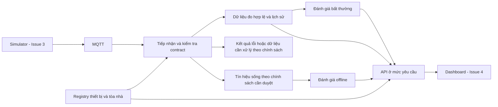

# Yêu cầu Backend/API và luồng dữ liệu APP-05

Trạng thái: **bản nháp để rà soát**, chưa phải thiết kế hoặc contract đã được nhóm phê duyệt.

## Nguồn và giới hạn

- [Issue #2](https://github.com/nguyenthetai0012/SE2026---T06/issues/2): phạm vi Backend/API và tiêu chí hoàn thành.
- [README](../../README.md): phạm vi APP-05 đã được repo ghi nhận; [AGENTS.md](../../AGENTS.md): không tự quyết định stack/schema khi nhóm chưa thống nhất.
- Tài liệu nguồn được README dẫn: `APP05_KeHoach_TrienKhai_ChiTiet.docx`, mục 2.1. **Bản Word đính kèm chưa đọc được trong phiên soạn này** vì công cụ tải tệp yêu cầu môi trường thực thi chưa có. Không coi bản nháp này là kết quả đối chiếu trực tiếp toàn bộ Word.
- [Issue #3](https://github.com/nguyenthetai0012/SE2026---T06/issues/3): An/schema MQTT/Simulator; [#4](https://github.com/nguyenthetai0012/SE2026---T06/issues/4): Sương/Dashboard; [#5](https://github.com/nguyenthetai0012/SE2026---T06/issues/5): Ngọc/kiểm thử.

Phạm vi được các nguồn đã đọc xác nhận: nhận dữ liệu cảm biến giả lập qua MQTT từ nhiều tòa nhà, registry thiết bị, Dashboard, lịch sử chuỗi thời gian, cảnh báo bất thường và trạng thái offline. Simulator, schema contract, load test và late/out-of-order tests là các hạng mục kiểm chứng.

Các hành vi chi tiết, tiêu chí nghiệm thu và luồng dưới đây là **đề xuất cần nhóm duyệt**. Chưa chọn broker, ngôn ngữ/framework, DB, topic, schema, đường dẫn HTTP, cơ chế realtime, ngưỡng hoặc chỉ tiêu tải.

## Chức năng và tiêu chí nghiệm thu đề xuất

| ID | Chức năng | Hành vi cần làm rõ | Tiêu chí nghiệm thu đề xuất |
| --- | --- | --- | --- |
| BE-01 | Nhận dữ liệu MQTT | Kiểm tra bản tin theo contract được duyệt; liên kết thiết bị/tòa nhà; lưu kết quả hợp lệ; phân biệt thời điểm đo và thời điểm nhận. Chính sách bản tin lỗi/trùng/không rõ thiết bị cần chốt với An. | Bản tin hợp lệ xuất hiện trong lịch sử đúng thiết bị/tòa nhà và đơn vị; bản tin lỗi có lý do quan sát được, không làm dừng luồng; dữ liệu trùng xử lý đúng chính sách đã duyệt. |
| BE-02 | Quản lý thiết bị | Tra cứu danh sách/chi tiết và quan hệ tòa nhà; đề xuất đăng ký/cập nhật thông tin. Quyền thao tác và vòng đời thiết bị cần duyệt; chưa mặc định cho phép xóa. | Thiết bị đăng ký theo quy tắc đã duyệt tra cứu được; định danh trùng và quan hệ tòa nhà không hợp lệ có lỗi rõ; cập nhật không làm mất lịch sử hoặc chuyển lịch sử sang thiết bị khác. |
| BE-03 | Truy vấn chuỗi thời gian | Lọc theo thiết bị/tòa nhà, metric và khoảng thời gian; trả đơn vị, thời điểm đo, thứ tự và thông tin giới hạn kết quả. Tổng hợp chỉ có khi nhóm duyệt công thức. | Fixture có nhiều tòa nhà chỉ trả dữ liệu đúng bộ lọc; kiểm thử biên thời gian theo quy ước đã duyệt; kết quả rỗng phân biệt lỗi; bản tin đến trễ/sai thứ tự được xử lý đúng chính sách, không xếp lịch sử theo thời điểm nhận một cách ngầm định. |
| BE-04 | Cảnh báo bất thường | Đánh giá theo quy tắc/ngưỡng được duyệt; cung cấp thiết bị/tòa nhà, thời điểm, giá trị và lý do cảnh báo. Chống lặp, vòng đời và ảnh hưởng dữ liệu trễ cần chốt. | Fixture bình thường không tạo cảnh báo; fixture thỏa điều kiện tạo cảnh báo với bằng chứng đo; fixture sát biên, trùng và trễ cho kết quả theo quy tắc đã duyệt; API trả được cảnh báo đúng bộ lọc. |
| BE-05 | Trạng thái offline | Suy ra từ tín hiệu sống được nhóm chọn và mốc thời gian nhận; cung cấp trạng thái, lần liên lạc gần nhất và thời điểm đánh giá. Chưa chọn timeout/heartbeat. | Kiểm thử trước/tại/sau mốc timeout theo quy ước đã duyệt; bản tin đo cũ vừa đến không làm sai lần liên lạc gần nhất; thiết bị chưa có tín hiệu không bị hiển thị online thiếu căn cứ; khôi phục tín hiệu cập nhật trạng thái theo chính sách đã duyệt. |
| BE-06 | Cấp dữ liệu Dashboard | Cung cấp tổng quan, danh sách thiết bị, lịch sử, alerts/offline và độ mới dữ liệu theo nhu cầu duyệt với Sương. | Các màn hình trong #4 có nguồn dữ liệu tương ứng; dữ liệu rỗng, thiếu một phần, lỗi và offline phân biệt được; không cộng các metric/đơn vị không tương thích; công thức tổng quan có fixture đối chiếu. |

Các tiêu chí trên là kế hoạch nghiệm thu; chưa có implementation hoặc kết quả test pass.

## Luồng dữ liệu đề xuất

Sơ đồ chỉ mô tả trách nhiệm logic, không quy định số dịch vụ, hàng đợi, sản phẩm lưu trữ hoặc thứ tự transaction.

1. **Nhận dữ liệu:** An cung cấp fixture và schema đề xuất → Backend kiểm tra → phân loại hợp lệ/lỗi/trùng/trễ → xử lý theo quyết định được duyệt → cho phép truy vấn và đánh giá cảnh báo. Ghi nhận lỗi để đối chiếu; cách lưu hoặc loại bỏ chưa chốt.
2. **Registry:** người dùng/nguồn được cấp quyền yêu cầu thao tác → kiểm tra định danh và quan hệ tòa nhà → trả kết quả hoặc lỗi → lần truy vấn tiếp theo phản ánh thông tin. Nguồn registry và quyền thao tác chưa chốt.
3. **Lịch sử:** Dashboard gửi bộ lọc → kiểm tra khoảng thời gian/metric/phạm vi → trả chuỗi đo và metadata → Dashboard dựng biểu đồ. Giới hạn/phân trang và tổng hợp cần duyệt.
4. **Cảnh báo:** dữ liệu hợp lệ → quy tắc bất thường đã duyệt → kết quả cảnh báo có bằng chứng → Dashboard truy vấn/nhận cập nhật theo cơ chế nhóm chọn.
5. **Offline:** cập nhật tín hiệu sống theo chính sách → đánh giá tại thời điểm kiểm tra → trả trạng thái và độ mới → Dashboard hiển thị và cập nhật khi có tín hiệu trở lại. Không dùng thời điểm đo thay cho thời điểm nhận mà chưa có quyết định.
6. **Tổng quan:** Dashboard chọn phạm vi/thời gian → Backend trả dữ liệu theo công thức đã duyệt → giao diện phân biệt tổng đầy đủ với thiếu dữ liệu. Tổng hợp energy và power cần làm rõ riêng; chưa đặt tên/đơn vị metric.

## Trách nhiệm kiểm chứng

An cung cấp dữ liệu hợp lệ/lỗi/trùng/trễ/sai thứ tự (#3); Tài kiểm tra nhận và truy vấn; Sương kiểm tra đủ dữ liệu cho UI và các trạng thái (#4); Ngọc đưa tiêu chí đã duyệt vào ma trận kiểm thử/tải (#5). Đây là đề xuất phối hợp, chưa ghi nhận thành viên đã đồng ý.

Kịch bản tải phải chốt số thiết bị/tòa nhà, tốc độ gửi, thời lượng, truy vấn đồng thời và chỉ tiêu độ trễ/mất dữ liệu trước khi kết luận đạt. Không tự đặt con số hoặc tạo CI giả định stack.

## Điều kiện hoàn thành issue

- [x] Bản nháp mô tả các chức năng, luồng và tiêu chí nghiệm thu.
- [x] Liên kết nguồn đã đọc và issue phối hợp.
- [ ] Đọc trực tiếp Word, đối chiếu mục 2.1 và phân biệt backlog đề xuất với yêu cầu chính thức.
- [ ] An xác nhận đầu vào MQTT và chính sách trùng/trễ/sai thứ tự.
- [ ] Sương xác nhận dữ liệu Dashboard và công thức tổng quan.
- [ ] Ngọc rà soát khả năng kiểm chứng theo #5.
- [ ] Ít nhất một thành viên khác review PR; cập nhật quyết định và nội dung theo review.

Danh sách câu hỏi và nơi ghi bằng chứng ở [backend-data-boundaries.md](../contracts/backend-data-boundaries.md). Giữ issue mở đến khi đạt các điều kiện chưa hoàn thành; không coi việc tạo PR nháp là đã thống nhất thiết kế.

## Kịch bản nghiệm thu cụ thể để nhóm rà soát

Đây là fixture ở mức khái niệm, không quy định payload. Các chính sách có tham số phải được duyệt trước khi chạy test; không coi giá trị chưa chốt là mặc định.

| Mã | Dữ liệu vào/thao tác | Kết quả mong đợi đề xuất |
| --- | --- | --- |
| AC-01 / BE-01 | Hai thiết bị thuộc hai tòa nhà gửi mỗi thiết bị một bản tin hợp lệ | Lịch sử từng thiết bị có đúng điểm đo, metric/đơn vị và tòa nhà; không lẫn dữ liệu. |
| AC-02 / BE-01 | Bản tin thiếu định danh hoặc giá trị sai kiểu, tiếp theo là bản tin hợp lệ | Bản tin lỗi không trở thành điểm đo hợp lệ; có lý do lỗi; bản tin tiếp theo vẫn được xử lý. |
| AC-03 / BE-01 | Giao lại cùng một sự kiện | Số điểm đo và cảnh báo theo đúng chính sách chống trùng đã duyệt; không ngầm cộng năng lượng hai lần. Cách nhận diện sự kiện thuộc D-01/D-02. |
| AC-04 / BE-02 | Đăng ký thiết bị nếu thao tác này được duyệt, rồi tra cứu; thử định danh trùng | Tra cứu trả đúng thông tin; thao tác trùng trả lỗi rõ và không ghi đè thiết bị khác. |
| AC-05 / BE-03 | Ba thời điểm đo t1 < t2 < t3, nhưng nhận theo thứ tự t3, t1, t2 | Nếu chính sách cho phép cả ba, lịch sử tăng dần theo thời điểm đo trả t1, t2, t3; nếu có giới hạn dữ liệu trễ, đối chiếu điểm được nhận/từ chối với quyết định D-02. |
| AC-06 / BE-03 | Truy vấn một thiết bị trong khoảng thời gian có điểm đúng tại hai biên; truy vấn khoảng không có điểm | Điểm tại biên được lấy/loại theo D-05; khoảng rỗng trả kết quả rỗng, phân biệt với lỗi; không chứa điểm của thiết bị khác. |
| AC-07 / BE-04 | Fixture bình thường, fixture thỏa điều kiện bất thường và fixture tại biên ngưỡng | Chỉ tạo cảnh báo theo quy tắc D-06; trả thiết bị, thời điểm, giá trị/đơn vị và lý do. Không tự giả định so sánh lớn hơn hay lớn hơn hoặc bằng. |
| AC-08 / BE-05 | Thiết bị có tín hiệu sống tại r; đánh giá trước, tại và sau timeout T | Trạng thái đúng quy tắc biên D-07; T do nhóm chọn. API cung cấp r và thời điểm đánh giá để UI giải thích trạng thái. |
| AC-09 / BE-05 | Thiết bị chưa từng liên lạc; thiết bị offline có tín hiệu mới; bản tin đo cũ/replay đến sau | Không gán online thiếu căn cứ; phục hồi theo D-07; bản tin cũ/replay chỉ cập nhật tín hiệu sống nếu chính sách cho phép. |
| AC-10 / BE-06 | Dashboard tải tổng quan, danh sách, lịch sử và cảnh báo bằng cùng phạm vi | Bộ lọc và định danh nhất quán; trạng thái rỗng, lỗi tải, offline và độ mới phân biệt được; dữ liệu thiếu không tự biến thành 0. |
| AC-11 / BE-06 | Nguồn chỉ có công suất W, hoặc chứa phép đo năng lượng tích lũy | Không cộng mẫu W thành kWh; không cộng các chỉ số tích lũy một cách ngầm định. Chỉ trả điện năng/tổng quan khi D-04 đã xác định công thức, thời gian và cách xử lý khoảng thiếu/reset. |

## Đối chiếu yêu cầu Issue #2 với tài liệu

| Yêu cầu issue | Nội dung để rà soát | Trạng thái |
| --- | --- | --- |
| Liệt kê chức năng Backend | BE-01 đến BE-05; BE-06 hỗ trợ Dashboard | Đã có bản nháp |
| Mô tả luồng API ở mức yêu cầu | Sáu luồng dữ liệu và bảng năng lực API trong tài liệu contract | Đã có bản nháp |
| Phối hợp đầu vào với An, đầu ra với Sương | D-01/D-02/D-07 và D-04/D-05/D-08 trong tài liệu contract | Cần phản hồi thành viên; chưa ghi nhận thống nhất |
| Ghi tài liệu trong thư mục quy định | Tài liệu này và ../contracts/backend-data-boundaries.md | Có trên nhánh PR |
| Mỗi chức năng có mô tả và tiêu chí nghiệm thu | BE-01…BE-06 và AC-01…AC-11 | Đã soạn; chờ rà soát tiêu chí |
| Không chốt công nghệ khi nhóm chưa thống nhất | Không chọn broker, runtime/framework hoặc DB | Đã giữ đúng phạm vi |
| Liên kết Issue/PR và review thành viên khác | [PR #7](https://github.com/nguyenthetai0012/SE2026---T06/pull/7), #2/#3/#4/#5 | Có liên kết; review thành viên còn thiếu |
