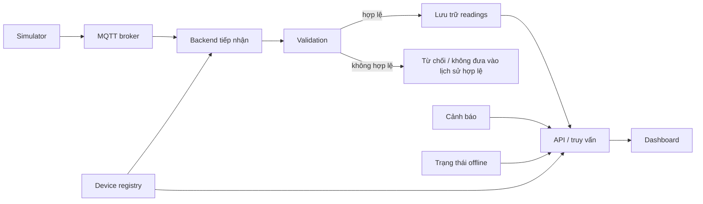

# Kiến trúc tổng thể và luồng dữ liệu APP-05

- Issue nguồn: [#2 — Chốt yêu cầu Backend/API và luồng dữ liệu](https://github.com/nguyenthetai0012/SE2026---T06/issues/2)
- Phụ trách: Tài chủ trì; An xác nhận Simulator/MQTT; Sương xác nhận Dashboard; Ngọc rà soát điểm kiểm thử
- Trạng thái: **bản nháp**; không thay thế contract Dashboard đã rà soát tại [PR #13](https://github.com/nguyenthetai0012/SE2026---T06/pull/13)
- Đối chiếu: [`docs/contracts/backend-api.md`](../contracts/backend-api.md), [`docs/requirements/dashboard.md`](../requirements/dashboard.md), MQTT draft [PR #10](https://github.com/nguyenthetai0012/SE2026---T06/pull/10) / Issue #3

Tài liệu dùng **vai trò thành phần**, không chốt runtime, broker, hay cơ sở dữ liệu. Stack thuộc Issue [#20](https://github.com/nguyenthetai0012/SE2026---T06/issues/20) (Backend/Simulator) và [#11](https://github.com/nguyenthetai0012/SE2026---T06/issues/11) (Frontend). Endpoint/schema HTTP thuộc Issue [#21](https://github.com/nguyenthetai0012/SE2026---T06/issues/21).

Mỗi quyết định đánh dấu **[ĐÃ XÁC NHẬN]**, **[ĐỀ XUẤT]** hoặc **[CÒN MỞ]**.

---

## 1. Sơ đồ luồng

**[ĐÃ XÁC NHẬN]** Dữ liệu cảm biến giả lập đi MQTT vào Backend, được lưu để truy vấn chuỗi thời gian, phục vụ Dashboard, cảnh báo bất thường và trạng thái offline.

---

## 2. Ranh giới thành phần

| Thành phần | Chịu trách nhiệm | Không làm |
| --- | --- | --- |
| Simulator | Sinh payload/fixtures tái lập (hợp lệ, lỗi, trễ, sai thứ tự, trùng) theo contract MQTT sau khi duyệt | Không tính tổng quan tòa nhà, không tạo cảnh báo Dashboard, không quyết định offline hiển thị |
| MQTT broker | Chuyển bản tin Simulator → Backend | Không validation nghiệp vụ, không registry |
| Backend tiếp nhận / validation | Nhận bản tin, đối chiếu registry và schema, chấp nhận hoặc từ chối | Không tự đặt schema MQTT khác với #3 |
| Lưu trữ readings | Giữ reading hợp lệ gắn thiết bị/tòa nhà và timestamp nguồn | Không tự suy nghĩa metric nếu contract chưa chốt |
| Device registry | Định danh tòa nhà/thiết bị và liên hệ giữa chúng | Không thay thế lịch sử cảm biến |
| Cảnh báo | Backend tạo bản ghi bất thường theo chính sách đã duyệt | Dashboard không tự phát hiện ngưỡng |
| Trạng thái offline | Backend suy ra online/offline (và last-seen nếu có) | Không đồng nhất với lỗi tải API hoặc lịch sử rỗng |
| API / truy vấn | Cung cấp tổng quan, thiết bị, lịch sử, cảnh báo, trạng thái; phân biệt có data / rỗng / lỗi | Không chốt path HTTP trong tài liệu này (#21) |
| Dashboard | Hiển thị dữ liệu Backend; loading / rỗng / lỗi / offline / cũ-trễ | Không tự cộng năng lượng; không suy offline từ lỗi tải |

Registry, cảnh báo và offline **độc lập với** tập readings trả về một truy vấn lịch sử: thiết bị có thể offline dù lịch sử còn bản ghi cũ; truy vấn rỗng không có nghĩa là offline.

---

## 3. Một reading hợp lệ — từ sinh đến hiển thị

1. Simulator tạo bản tin cho thiết bị thuộc một tòa nhà. **[ĐỀ XUẤT]** các trường theo draft MQTT: `building_id`, `device_id`, `event_time`, `metric`, `value`, `message_id`, `schema_version`. Schema chính thức dẫn Issue #3 / PR #10, không định nghĩa lại ở đây.
2. Broker chuyển bản tin tới Backend.
3. Backend ghi **thời điểm nhận** (`received_at` — **[ĐỀ XUẤT]** tên; **[ĐÃ XÁC NHẬN]** cần phân biệt với thời điểm đo). Trường này **do Backend gắn**, không do Simulator gửi.
4. Validation: định danh có trong registry, kiểu/giá trị theo contract. Hợp lệ → lưu reading gắn đúng tòa nhà/thiết bị, giữ `event_time` nguồn.
5. Dashboard yêu cầu lịch sử theo đối tượng và khoảng thời gian. Backend lọc/sắp xếp theo **thời điểm đo** (**[ĐỀ XUẤT]** `event_time`).
6. Dashboard hiển thị thời điểm, giá trị, đơn vị; nhãn cũ/đến trễ nếu Backend cung cấp (AC-10).

Nguồn ý nghĩa:

| Thông tin | Nguồn | Trạng thái |
| --- | --- | --- |
| Định danh tòa nhà / thiết bị | Payload MQTT + registry Backend | **[CÒN MỞ]** quy tắc ID cuối cùng — An, Tài |
| Thời điểm đo | Simulator / cảm biến | **[ĐỀ XUẤT]** `event_time` |
| Thời điểm nhận | Backend | **[ĐỀ XUẤT]** `received_at` |
| Đơn vị hiển thị | Mapping metric → đơn vị | **[ĐỀ XUẤT]** trên MQTT draft; **[CÒN MỞ]** danh sách chính thức |
| Giá trị tổng quan tòa nhà | Backend tính/cung cấp sẵn | **[ĐÃ XÁC NHẬN]** Frontend không tự cộng; **[CÒN MỞ]** công thức kWh |

---

## 4. Đường xử lý dữ liệu không chuẩn

| Tình huống | Hành vi đề xuất | Trạng thái |
| --- | --- | --- |
| Không hợp lệ (thiếu trường, sai kiểu, timestamp sai, ID không có trong registry) | Backend **từ chối**; không đưa vào lịch sử như reading hợp lệ | **[ĐỀ XUẤT]** (khớp draft #3); cách log/phản hồi MQTT **[CÒN MỞ]** |
| Trùng (`message_id` giống nhau) | Idempotent: chỉ ghi nhận một lần | **[ĐỀ XUẤT]**; khóa và hành vi chi tiết — Tài, An |
| Đến trễ (`event_time` lùi, nhận ở hiện tại) | Vẫn lưu nếu hợp lệ; truy vấn theo `event_time`; có thể gắn nhãn trễ | **[ĐỀ XUẤT]**; ngưỡng **[CÒN MỞ]** |
| Sai thứ tự | Giữ cả hai reading; sắp xếp lịch sử theo `event_time` | **[ĐỀ XUẤT]** |

Không khẳng định dữ liệu trễ bị loại hay không tạo cảnh báo cho đến khi nhóm chốt.

---

## 5. Luồng truy vấn Dashboard

Khớp FLOW-01…05 và mục 2.5 `backend-api.md`:

1. Dashboard gọi API với đối tượng/khoảng/bộ lọc hiện tại.
2. **Đang tải** cho đến khi có phản hồi hoặc lỗi (AC-07).
3. **Thành công có dữ liệu** → hiển thị, gắn đúng tòa nhà/thiết bị (AC-12).
4. **Thành công rỗng** → “không có dữ liệu” cho phạm vi đó, **không** phải lỗi, **không** phải offline (AC-08, AC-11).
5. **Lỗi truyền/tải** → báo lỗi + retry **cùng điều kiện truy vấn**; kết quả lần sau có thể khác nếu có ingest mới (AC-09). Lỗi **không** biến thành nhãn offline.
6. Offline chỉ khi Backend gắn trạng thái đó trên thiết bị.

Cơ chế cập nhật Dashboard (polling / đẩy realtime): **[CÒN MỞ]** — không tự thêm websocket. Xác thực: **[CÒN MỞ]** — không tự thêm đăng nhập.

---

## 6. Quyết định liên quan và đầu việc tiếp theo

| Chủ đề | Tài liệu / Issue | Ảnh hưởng triển khai |
| --- | --- | --- |
| Nhu cầu dữ liệu Dashboard | `backend-api.md`, `dashboard.md` | API phải phủ FLOW/AC; Q1–Q14 còn mở |
| MQTT payload, trễ/sai thứ tự | #3, PR #10 | Intake/validation/fixtures |
| Stack Backend, broker, lưu trữ, Simulator | **#20** | Tạo khung `src/backend/`, `src/simulator/` |
| Stack Frontend | **#11** | Không quyết định trong file này |
| Endpoint, field HTTP, ví dụ JSON API | **#21** | Tích hợp Backend–Frontend thật |
| Kế hoạch kiểm thử | #5 / `docs/testing/test_plan.md` | Fixture hợp lệ/lỗi/trễ/offline |
| Hướng dẫn chạy tích hợp | **#22** | Sau khi có stack và code chạy được |

Issue #2 (phần kiến trúc này) **không** bắt buộc xong #20/#21/#22 mới đóng, nhưng không được mâu thuẫn với các contract trên.

---

## 7. Checklist rà soát kiến trúc

- [ ] An: luồng Simulator → broker → intake khớp draft MQTT; `event_time` / `received_at`; chu kỳ gửi.
- [ ] Sương: luồng truy vấn và ba trạng thái kết quả khớp Dashboard; retry không đòi dữ liệu giống hệt.
- [ ] Ngọc: đủ để gắn test ingestion, late/out-of-order, empty vs error vs offline.
- [x] Không tự đặt endpoint, schema HTTP, công thức kWh, ngưỡng cảnh báo/offline, hay sản phẩm broker/DB.
